# LCARS-FAS databases

Generated by `0_tools/dbDiagrams.py` on 2026-10-24 UTC from the real database files (read-only) or, where a database file is not on this machine, from the CREATE statements in the code. Run `python 0_tools/dbDiagrams.py` to regenerate everything here; do not edit these files by hand.

Conventions: `ingestion<Source>.db` holds what a source gave us; `site<Type>.db` is what the website reads, rebuilt whole by `scripts/publishSite.py`; `inbox<Name>.db` is written by visitors through the server. Visitors never touch an ingestion database. All times are UTC.

## Overview

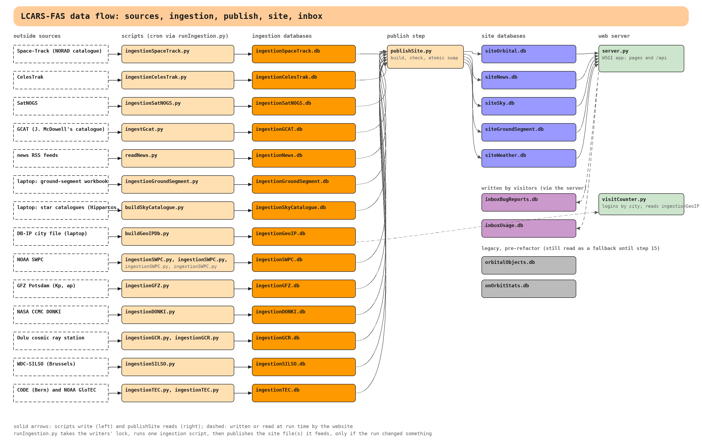

(SVG: [overview.svg](overview.svg).) The Mermaid source for every diagram is in [schemas.md](schemas.md).

## ingestionSpaceTrack.db

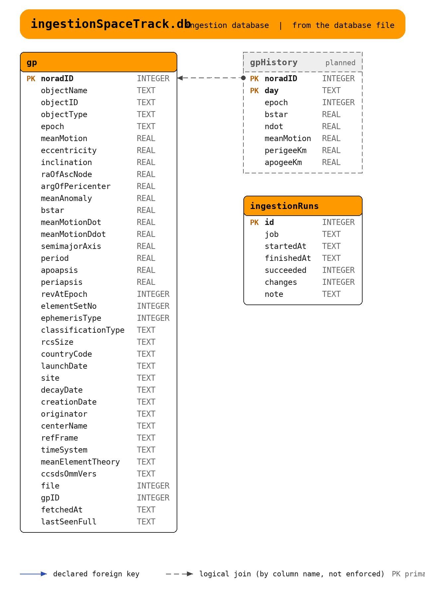 ([SVG](ingestionSpaceTrack.db.svg))

The NORAD satellite catalogue (via Space-Track): the newest general-perturbations element set for every tracked object, one row per object, plus the run history. The only source of orbital elements for the site. **Written by:** scripts/ingestionSpaceTrack.py (cron 00:00 and 12:00 server time). **Read by:** scripts/publishSite.py (orbital). **Where:** LIVE and DEV. **Rebuilt:** rebuilt by the next full pass (nothing is lost if deleted, but history of runs is). **Size:** 12.82 MB on this machine. **Tables:** 2 (plus planned: gpHistory). **Schema source:** introspected from the file databases\ingestionSpaceTrack.db (a read-only copy; the original is never opened). planned: gpHistory, one row per object per day, for drag work.

Schema notes (generated):

- No foreign keys are declared; the dashed lines are joins by convention only.

## ingestionCelesTrak.db

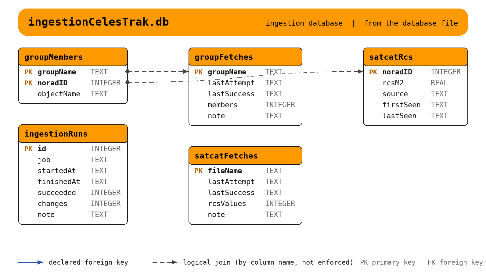 ([SVG](ingestionCelesTrak.db.svg))

CelesTrak group memberships (which satellites belong to which named group), the radar cross-section (RCS) figures kept for good, and when each group was last fetched. Disabled in FAS for now (CELESTRAK_ENABLED=0 on the server), so mostly static. **Written by:** scripts/ingestionCelesTrak.py (every third day). **Read by:** scripts/publishSite.py (orbital groups). **Where:** LIVE and DEV. **Rebuilt:** refetched by the job; RCS figures are kept across rebuilds. **Size:** 5.28 MB on this machine. **Tables:** 5. **Schema source:** introspected from the file databases\ingestionCelesTrak.db (a read-only copy; the original is never opened).

Schema notes (generated):

- No foreign keys are declared; the dashed lines are joins by convention only.

## ingestionSatNOGS.db

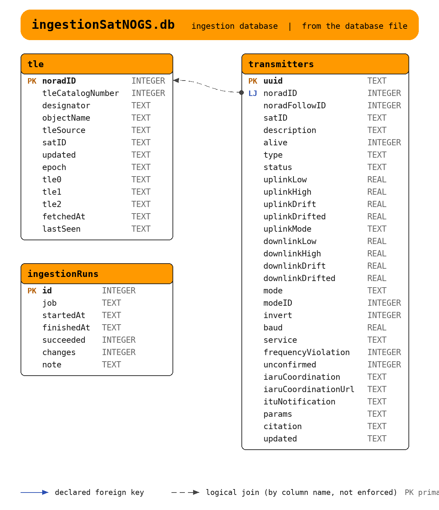 ([SVG](ingestionSatNOGS.db.svg))

SatNOGS transmitters (radio downlinks and uplinks) and the TLE feed used only as an ID crosswalk (designators). **Written by:** scripts/ingestionSatNOGS.py (cron 00:30 and 12:30). **Read by:** scripts/publishSite.py (orbital radio). **Where:** LIVE and DEV. **Rebuilt:** refetched by the job. **Size:** 2.55 MB on this machine. **Tables:** 3. **Schema source:** introspected from the file databases\ingestionSatNOGS.db (a read-only copy; the original is never opened).

Schema notes (generated):

- No foreign keys are declared; the dashed lines are joins by convention only.

## ingestionGCAT.db

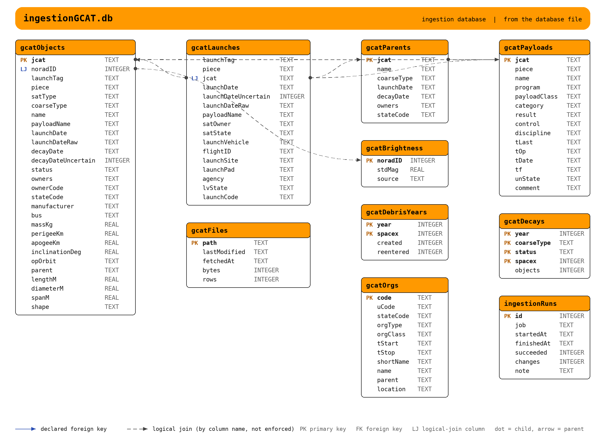 ([SVG](ingestionGCAT.db.svg))

Jonathan McDowell's General Catalog of Artificial Space Objects: objects, payloads, organisations, launches, decays and derived brightness estimates, with the files' fetch record. **Written by:** scripts/ingestGcat.py (Sundays 03:00); scripts/estimateBrightness.py fills gcatBrightness. **Read by:** scripts/publishSite.py, scripts/orbitStats.py, scripts/enrichEirp.py. **Where:** LIVE and DEV. **Rebuilt:** refetched weekly (about 30 MB of source files). **Size:** 18.83 MB on this machine. **Tables:** 10. **Schema source:** introspected from the file databases\ingestionGCAT.db (a read-only copy; the original is never opened).

Schema notes (generated):

- `gcatLaunches` has no primary key.
- No foreign keys are declared; the dashed lines are joins by convention only.

## ingestionNews.db

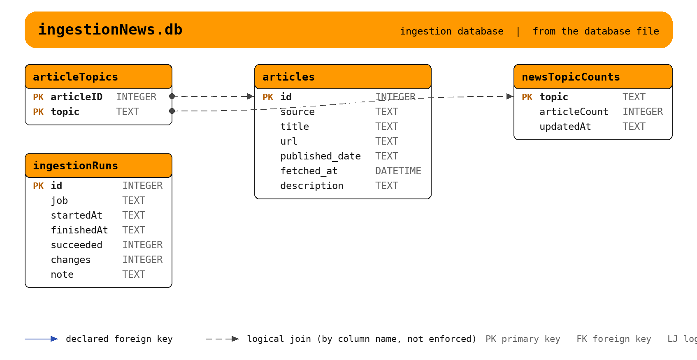 ([SVG](ingestionNews.db.svg))

Space news articles from 18 RSS feeds, their topic tags and the topic counts the site shows. **Written by:** scripts/readNews.py (every 30 min), scripts/tagNews.py, scripts/pruneNews.py. **Read by:** scripts/publishSite.py (news). **Where:** LIVE and DEV. **Rebuilt:** refilled by the feeds; old articles pruned. **Size:** 1.73 MB on this machine. **Tables:** 4. **Schema source:** introspected from the file databases\ingestionNews.db (a read-only copy; the original is never opened).

Schema notes (generated):

- No foreign keys are declared; the dashed lines are joins by convention only.

## ingestionGroundSegment.db

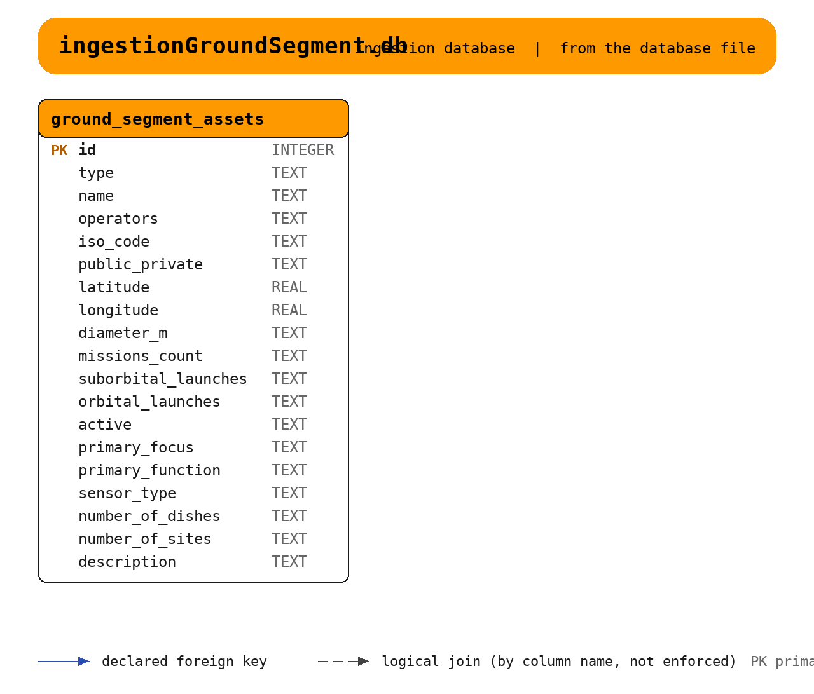 ([SVG](ingestionGroundSegment.db.svg))

Ground-segment sites (stations, teleports) for the GRND SGMNT map. A reference database built on the laptop from the master workbook. **Written by:** scripts/ingestionGroundSegment.py (laptop). **Read by:** scripts/publishSite.py (groundSegment), server.py (legacy fallback). **Where:** LIVE (uploaded by the deploy) and DEV. **Rebuilt:** rebuilt on the laptop from grndSgmntAssets_master.xlsx and deployed as a file. **Size:** 0.09 MB on this machine. **Tables:** 1. **Schema source:** introspected from the file databases\ingestionGroundSegment.db (a read-only copy; the original is never opened).

Schema notes (generated):

- No foreign keys are declared.

## ingestionSkyCatalogue.db

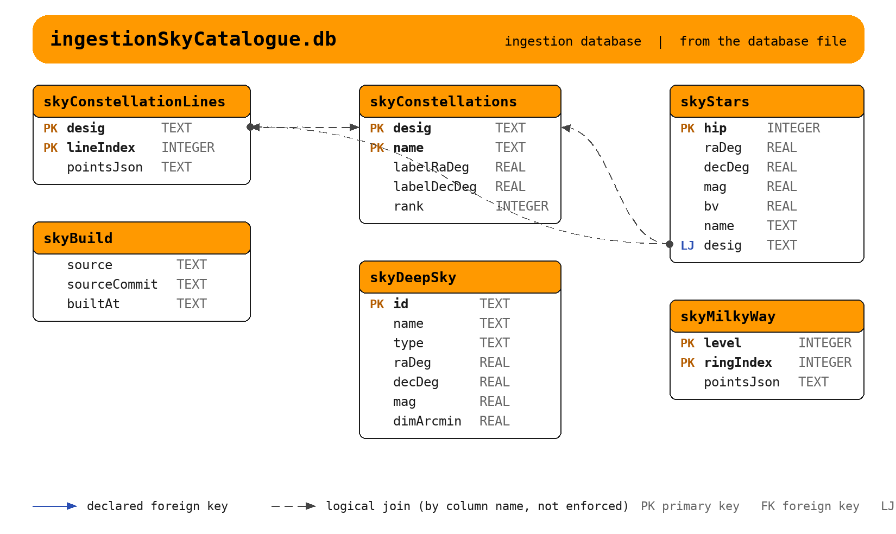 ([SVG](ingestionSkyCatalogue.db.svg))

The fixed sky for GRD VIEW: bright stars, constellation lines, Milky Way outline and deep-sky objects. A reference database built on the laptop. **Written by:** scripts/buildSkyCatalogue.py (laptop). **Read by:** scripts/publishSite.py (sky), server.py. **Where:** LIVE (uploaded by the deploy) and DEV. **Rebuilt:** rebuilt on the laptop from the Hipparcos and Gaia match (10 arcsec radius) and deployed as a file. **Size:** 0.42 MB on this machine. **Tables:** 6. **Schema source:** introspected from the file databases\ingestionSkyCatalogue.db (a read-only copy; the original is never opened).

Schema notes (generated):

- `skyBuild` has neither a primary key nor an index: lookups scan the whole table.
- No foreign keys are declared; the dashed lines are joins by convention only.

## ingestionGeoIP.db

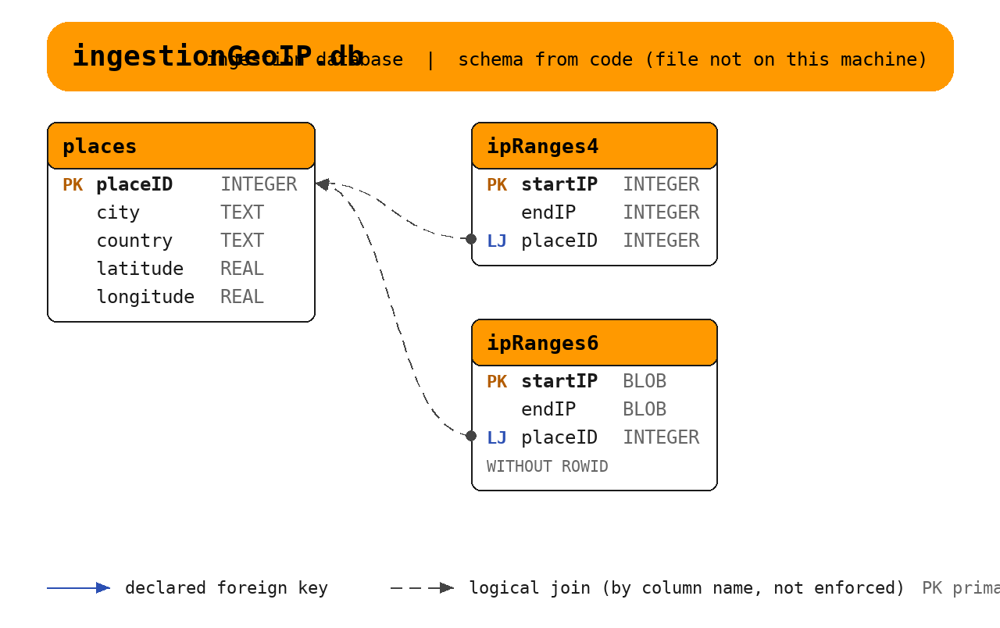 ([SVG](ingestionGeoIP.db.svg))

Lookup from visitor address ranges to cities (DB-IP city lite), used to count logins by city without keeping addresses. **Written by:** 0_tools/buildGeoIPDb.py (laptop, from the DB-IP CSV). **Read by:** scripts/visitCounter.py. **Where:** built on the laptop; whether it is on LIVE was not verified here. **Rebuilt:** rebuilt from a new DB-IP CSV. **Size:** not on this machine. **Tables:** 3. **Schema source:** the file does not exist on this machine; schema read from the code that creates it; CREATE statements in 0_tools/buildGeoIPDb.py.

Schema notes (generated):

- No foreign keys are declared; the dashed lines are joins by convention only.

## ingestionSWPC.db

 ([SVG](ingestionSWPC.db.svg))

NOAA SWPC real-time space weather: solar wind and field at L1, GOES X-ray and protons, Kp, Dst, F10.7, forecasts, flare and radio events, and the newest OVATION and D-RAP maps. One long table of (series, time, value) plus events and maps. **Written by:** scripts/ingestionSWPC.py (jobs swpcFast every 15 min, swpcSlow hourly, swpcMaps hourly, swpcPrune daily). **Read by:** scripts/publishSite.py (weather). **Where:** DEV only so far (not deployed). **Rebuilt:** 1-minute rows older than 90 days are deleted daily; other series are kept; refilled by the feeds (24 h of L1 and 7 days of GOES come from one first run). **Size:** 5.09 MB on this machine. **Tables:** 4. **Schema source:** introspected from the file databases\ingestionSWPC.db (a read-only copy; the original is never opened).

Schema notes (generated):

- No foreign keys are declared.

## ingestionGFZ.db

 ([SVG](ingestionGFZ.db.svg))

GFZ Potsdam geomagnetic indices: Kp, ap, daily Ap, Hp30, Hp60, F10.7 observed and adjusted, and the international sunspot number. **Written by:** scripts/ingestionGFZ.py (hourly; --backfill 90 once for history). **Read by:** scripts/publishSite.py (weather). **Where:** DEV only so far (not deployed). **Rebuilt:** refetched; preliminary values are replaced by definitive ones, never the reverse. **Size:** 1.87 MB on this machine. **Tables:** 4. **Schema source:** introspected from the file databases\ingestionGFZ.db (a read-only copy; the original is never opened).

Schema notes (generated):

- No foreign keys are declared.

## ingestionDONKI.db

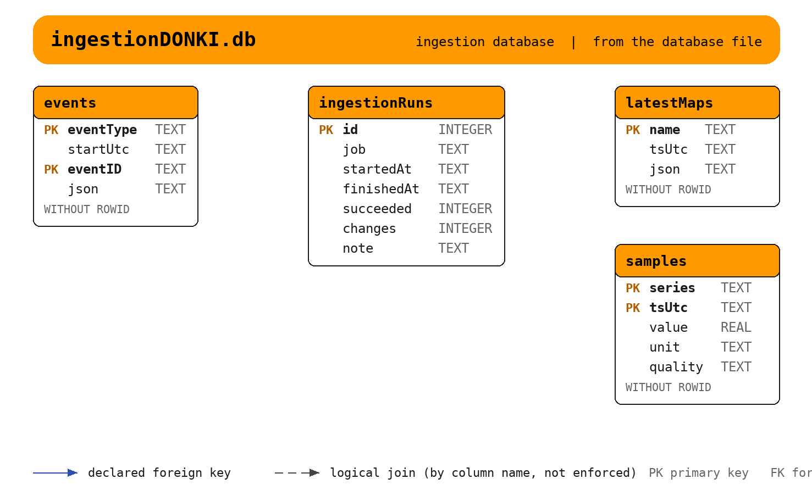 ([SVG](ingestionDONKI.db.svg))

NASA CCMC DONKI events: CME, HSS, GST, SEP, FLR and IPS, each stored whole as the source JSON. **Written by:** scripts/ingestionDONKI.py (hourly, last 7 days; --backfill 90 once for history). **Read by:** scripts/publishSite.py (weather). **Where:** DEV only so far (not deployed). **Rebuilt:** refetched; revised events replace older versions. **Size:** 1.74 MB on this machine. **Tables:** 4. **Schema source:** introspected from the file databases\ingestionDONKI.db (a read-only copy; the original is never opened).

Schema notes (generated):

- No foreign keys are declared.

## ingestionGCR.db

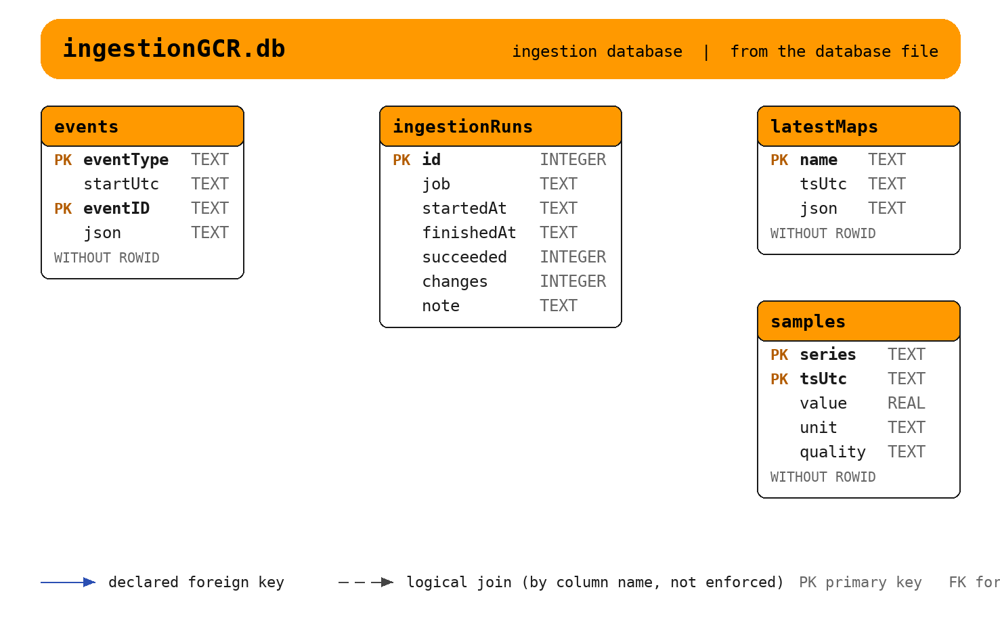 ([SVG](ingestionGCR.db.svg))

Neutron-monitor count rates (galactic cosmic rays) from the Oulu cosmic ray station's own online query: Oulu and Dome C, pressure-corrected and raw counts and air pressure, hourly, plus the monthly record since 1964. Credit: the Oulu cosmic ray station site and the Sodankyla Geophysical Observatory. **Written by:** scripts/ingestionGCR.py (job gcr hourly, gcrMonthly monthly; --backfill DAYS once for history). **Read by:** scripts/publishSite.py (weather). **Where:** DEV only so far (not deployed). **Rebuilt:** refetched; nothing is deleted (hourly data are about 1.6 MB a year per station). **Size:** 0.56 MB on this machine. **Tables:** 4. **Schema source:** introspected from the file databases\ingestionGCR.db (a read-only copy; the original is never opened).

Schema notes (generated):

- No foreign keys are declared.

## ingestionSILSO.db

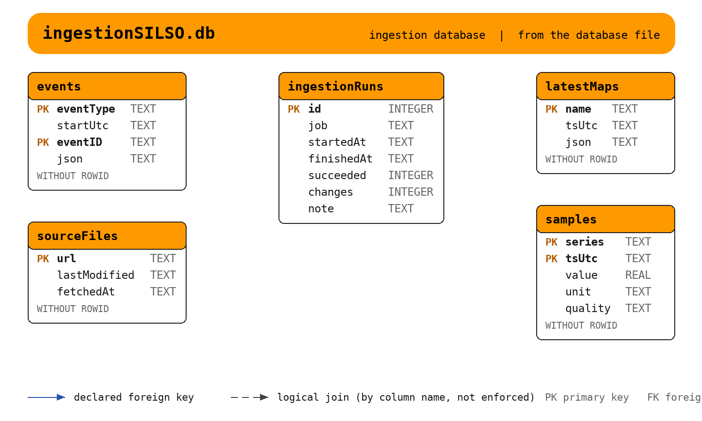 ([SVG](ingestionSILSO.db.svg))

WDC-SILSO monthly mean sunspot number since 1749 (mean, standard deviation, observations; definitive or provisional). CC BY-NC 4.0, credit WDC-SILSO, Royal Observatory of Belgium, Brussels. **Written by:** scripts/ingestionSILSO.py (monthly; a HEAD request checks Last-Modified first). **Read by:** scripts/publishSite.py (weather). **Where:** DEV only so far (not deployed). **Rebuilt:** refetched when the file changes; provisional months become definitive about a quarter later. **Size:** 0.77 MB on this machine. **Tables:** 5. **Schema source:** introspected from the file databases\ingestionSILSO.db (a read-only copy; the original is never opened).

Schema notes (generated):

- No foreign keys are declared.

## ingestionTEC.db

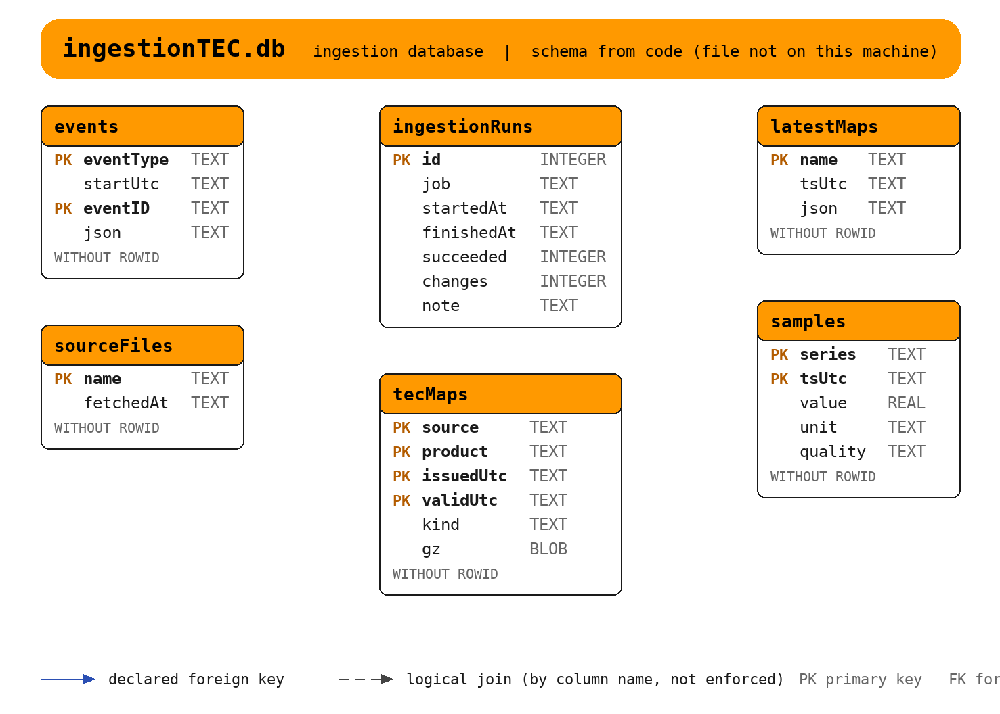 ([SVG](ingestionTEC.db.svg))

Global total electron content (TEC) maps, 7 days: CODE (Astronomical Institute, University of Bern) hourly maps observed (rapid, previous day) and predicted 1, 2 and 5 days ahead, 71 x 73 cells; NOAA SWPC GloTEC every 3 hours, 72 x 72 cells with TEC, anomaly, NmF2, hmF2. Each map is a gzipped compact JSON; global-maximum summaries are in samples. Credit: CODE, Dach et al. (2026), DOI 10.48620/97772; NOAA SWPC. **Written by:** scripts/ingestionTEC.py (job tecCode daily 09:15 UTC, tecGlotec every 3 hours). **Read by:** scripts/publishSite.py (weather). **Where:** DEV only so far (not deployed). **Rebuilt:** maps older than 7 days are deleted; a CODE file already held is never fetched again. **Size:** not on this machine. **Tables:** 6. **Schema source:** the file does not exist on this machine; schema read from the code that creates it; CREATE statements in scripts/spaceWeatherSamples.py; CREATE statements in scripts/ingestionLog.py; CREATE statements in scripts/ingestionTEC.py.

Schema notes (generated):

- No foreign keys are declared.

## siteOrbital.db

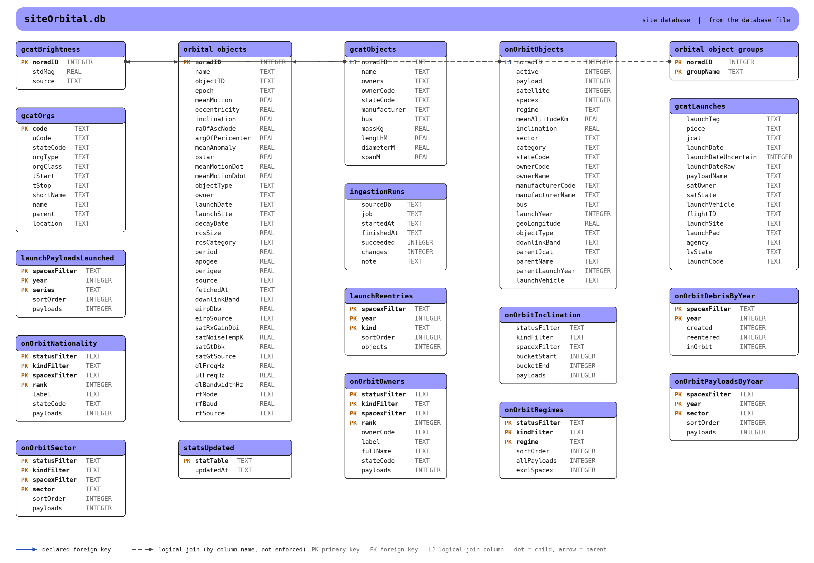 ([SVG](siteOrbital.db.svg))

What the website reads for everything orbital: the object catalogue with elements, groups, radio links, EIRP and brightness, the ON-ORBIT and LAUNCHES statistics, the GCAT tables the site uses, and every source's run history. **Written by:** scripts/publishSite.py (rebuilt from scratch and swapped in whole, with the previous file kept as .prev). **Read by:** server.py. **Where:** LIVE and DEV. **Rebuilt:** republished after every changing orbital ingestion run. **Size:** 25.45 MB on this machine. **Tables:** 18. **Schema source:** introspected from the file databases\siteOrbital.db (a read-only copy; the original is never opened).

Schema notes (generated):

- `gcatLaunches` has no primary key.
- `gcatObjects` has no primary key.
- `ingestionRuns` has no primary key (a site copy: rows are replaced as a whole on every publish).
- `onOrbitInclination` has neither a primary key nor an index: lookups scan the whole table.
- `onOrbitObjects` has neither a primary key nor an index: lookups scan the whole table.
- No foreign keys are declared; the dashed lines are joins by convention only.
- Join key `noradID` has different declared types: INT in gcatObjects; INTEGER in gcatBrightness, onOrbitObjects, orbital_object_groups, orbital_objects.

## siteNews.db

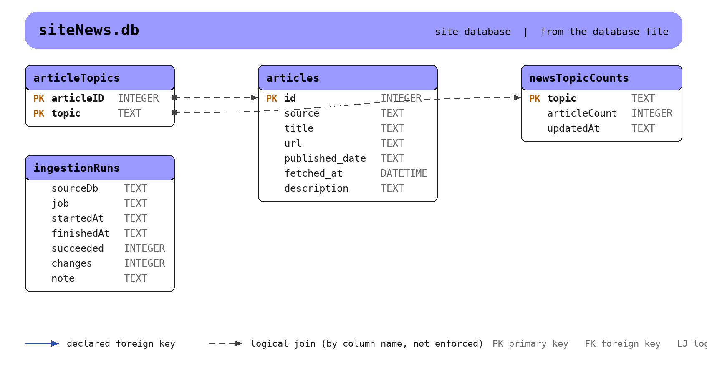 ([SVG](siteNews.db.svg))

Copy of the news tables the site reads. **Written by:** scripts/publishSite.py. **Read by:** server.py. **Where:** LIVE and DEV. **Rebuilt:** republished after a changing news run. **Size:** 1.72 MB on this machine. **Tables:** 4. **Schema source:** introspected from the file databases\siteNews.db (a read-only copy; the original is never opened).

Schema notes (generated):

- `ingestionRuns` has no primary key (a site copy: rows are replaced as a whole on every publish).
- No foreign keys are declared; the dashed lines are joins by convention only.

## siteSky.db

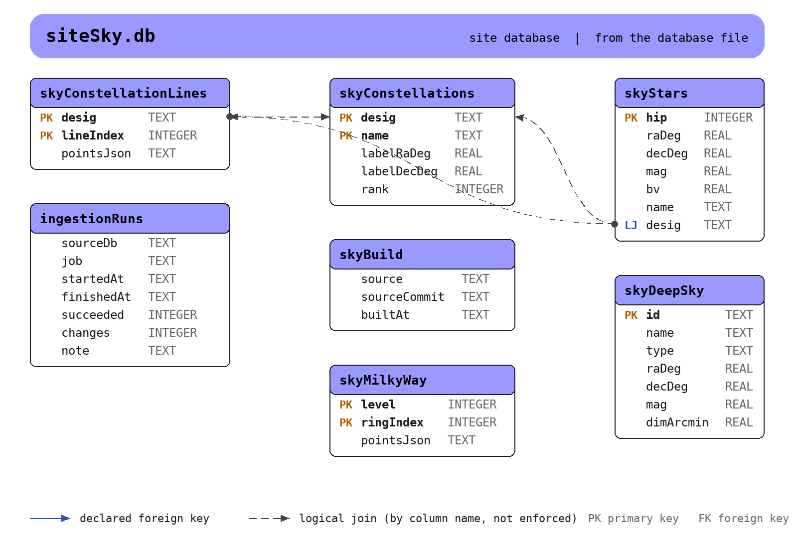 ([SVG](siteSky.db.svg))

Copy of the sky catalogue the site reads. **Written by:** scripts/publishSite.py. **Read by:** server.py. **Where:** LIVE and DEV. **Rebuilt:** republished from the sky reference database. **Size:** 0.43 MB on this machine. **Tables:** 7. **Schema source:** introspected from the file databases\siteSky.db (a read-only copy; the original is never opened).

Schema notes (generated):

- `ingestionRuns` has no primary key (a site copy: rows are replaced as a whole on every publish).
- `skyBuild` has neither a primary key nor an index: lookups scan the whole table.
- No foreign keys are declared; the dashed lines are joins by convention only.

## siteGroundSegment.db

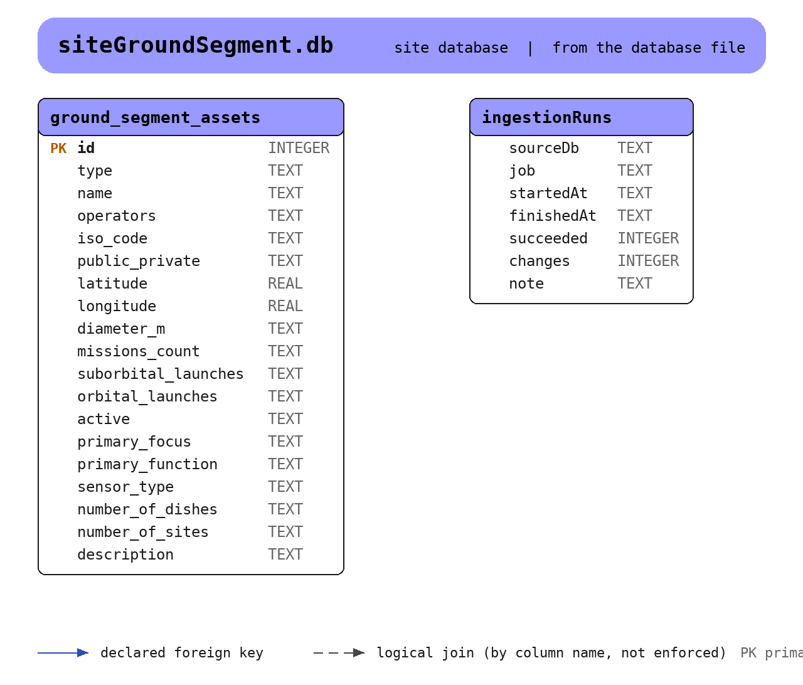 ([SVG](siteGroundSegment.db.svg))

Copy of the ground-segment table the site reads. **Written by:** scripts/publishSite.py. **Read by:** server.py. **Where:** LIVE and DEV. **Rebuilt:** republished from the reference database. **Size:** 0.10 MB on this machine. **Tables:** 2. **Schema source:** introspected from the file databases\siteGroundSegment.db (a read-only copy; the original is never opened).

Schema notes (generated):

- `ingestionRuns` has no primary key (a site copy: rows are replaced as a whole on every publish).
- No foreign keys are declared.

## siteWeather.db

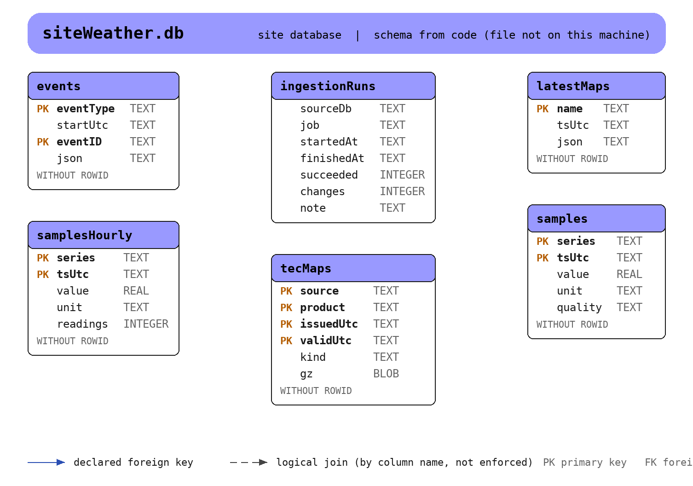 ([SVG](siteWeather.db.svg))

Everything the WEATHER panels read: full series, three days of the high-rate series at native resolution and 90 days as hourly means, events, the newest global maps, and derived series (F10.7A, storm scale). Visitors never touch the ingestion databases. **Written by:** scripts/publishSite.py (publishWeather; after every changing SWPC, GFZ or DONKI run). **Read by:** server.py (/api/weather/now, series, events, map, aurora-at). **Where:** DEV only so far (not deployed; the file is created by the first publish). **Rebuilt:** rebuilt from scratch each publish. **Size:** not on this machine. **Tables:** 6. **Schema source:** the file does not exist on this machine; schema read from the code that creates it; CREATE statements in scripts/publishSite.py; CREATE statements in scripts/publishSite.py.

Schema notes (generated):

- `ingestionRuns` has no primary key (a site copy: rows are replaced as a whole on every publish).
- No foreign keys are declared.

## inboxBugReports.db

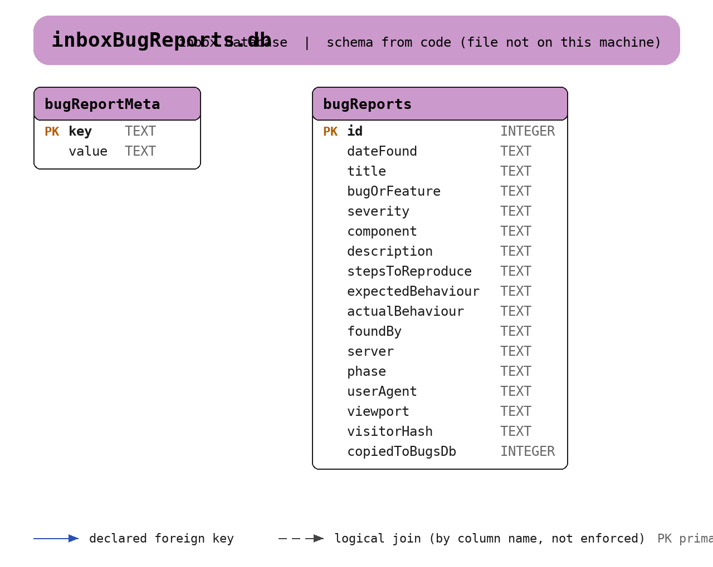 ([SVG](inboxBugReports.db.svg))

Bug reports submitted by visitors (no address kept, a salted visitor hash for rate limits). **Written by:** server.py (/api/bug-report). **Read by:** 0_tools/bugs.py copies them into the bug log (bugsDB.xlsx). **Where:** created on the first report on each host. **Rebuilt:** not rebuilt; it is the only copy of the reports. **Size:** not on this machine. **Tables:** 2. **Schema source:** the file does not exist on this machine; schema read from the code that creates it; CREATE statements in server.py.

Schema notes (generated):

- No foreign keys are declared.

## inboxUsage.db

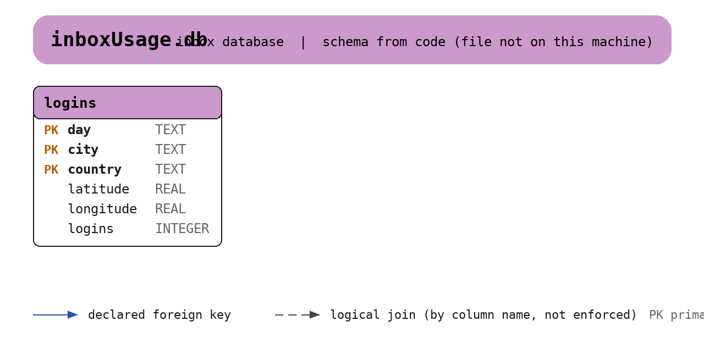 ([SVG](inboxUsage.db.svg))

Logins per day and city (counts only), for ABOUT > USAGE. **Written by:** scripts/visitCounter.py (one POST per browser session). **Read by:** server.py (/api/usage), 0_tools/seedUsageSample.py (writes sample rows on DEV). **Where:** created on the first visit on each host. **Rebuilt:** not rebuilt; counts accumulate. **Size:** not on this machine. **Tables:** 1. **Schema source:** the file does not exist on this machine; schema read from the code that creates it; CREATE statements in scripts/visitCounter.py.

Schema notes (generated):

- No foreign keys are declared.

## orbitalObjects.db

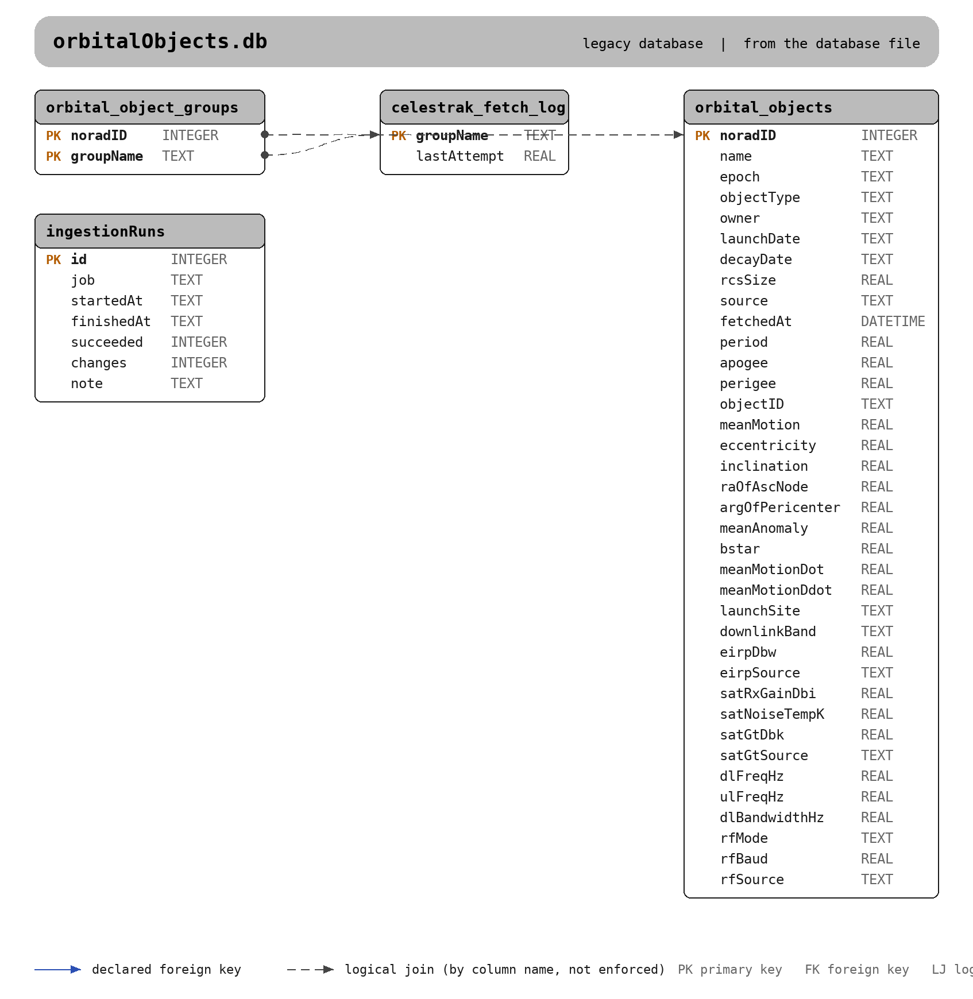 ([SVG](orbitalObjects.db.svg))

Pre-refactor orbital database: objects, group memberships and the CelesTrak fetch log. Replaced by siteOrbital.db; the server falls back to it where no site file exists. **Written by:** scripts/ingestOrbitalData.py, ingestSatcat.py, ingestSatnogsRf.py, enrichEirp.py (legacy pipeline). **Read by:** server.py (legacy fallback). **Where:** LIVE until the legacy fallback is removed (plan step 15), and DEV. **Rebuilt:** obsolete; to be removed in step 15 of dbRefactorPlan.md. **Size:** 11.99 MB on this machine. **Tables:** 4. **Schema source:** introspected from the file databases\orbitalObjects.db (a read-only copy; the original is never opened).

Schema notes (generated):

- No foreign keys are declared; the dashed lines are joins by convention only.

## onOrbitStats.db

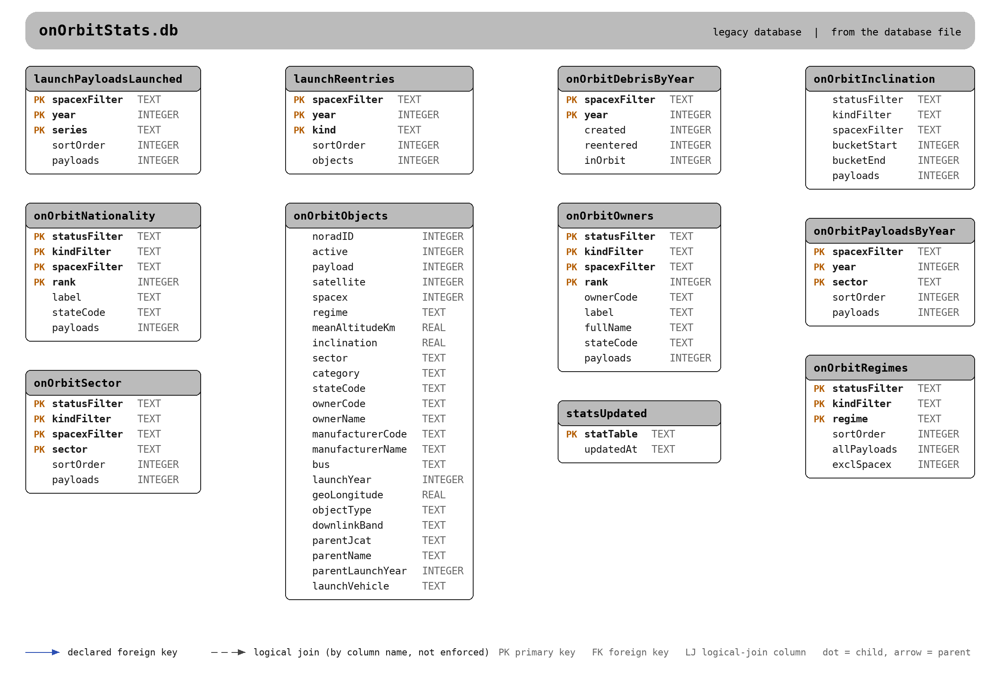 ([SVG](onOrbitStats.db.svg))

Pre-refactor ON-ORBIT and LAUNCHES statistics tables (now inside siteOrbital.db). **Written by:** scripts/orbitStats.py (legacy). **Read by:** server.py (legacy fallback). **Where:** LIVE until step 15, and DEV. **Rebuilt:** obsolete; to be removed in step 15. **Size:** 5.15 MB on this machine. **Tables:** 11. **Schema source:** introspected from the file databases\onOrbitStats.db (a read-only copy; the original is never opened).

Schema notes (generated):

- `onOrbitInclination` has neither a primary key nor an index: lookups scan the whole table.
- `onOrbitObjects` has neither a primary key nor an index: lookups scan the whole table.
- No foreign keys are declared.

## Not yet designed

Everything in `0_documentation/plans/spaceWeatherChartsPlan.md` that is stored has a database; the Space-Track history table (`gpHistory`) is planned.
