# LCARS-FAS database schemas (Mermaid)

Generated by `0_tools/dbDiagrams.py` from the real schemas on 2026-10-24 UTC. Do not edit by hand; run the tool again.
Solid lines are declared foreign keys; there are none, so every line is a logical join inferred from a shared join-key column name (written `..`).

## ingestionSpaceTrack.db

ingestion database; introspected from the file databases\ingestionSpaceTrack.db (a read-only copy; the original is never opened).

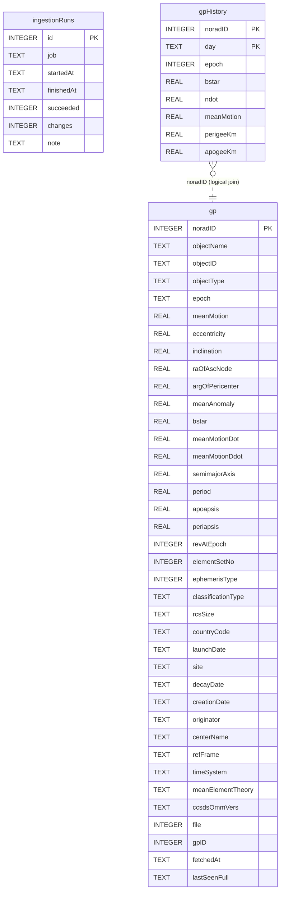

Indexes (besides the primary keys):

- `gp`: `gpByEpoch` on (epoch)
- `ingestionRuns`: `ingestionRunsByJob` on (job, finishedAt)

## ingestionCelesTrak.db

ingestion database; introspected from the file databases\ingestionCelesTrak.db (a read-only copy; the original is never opened).

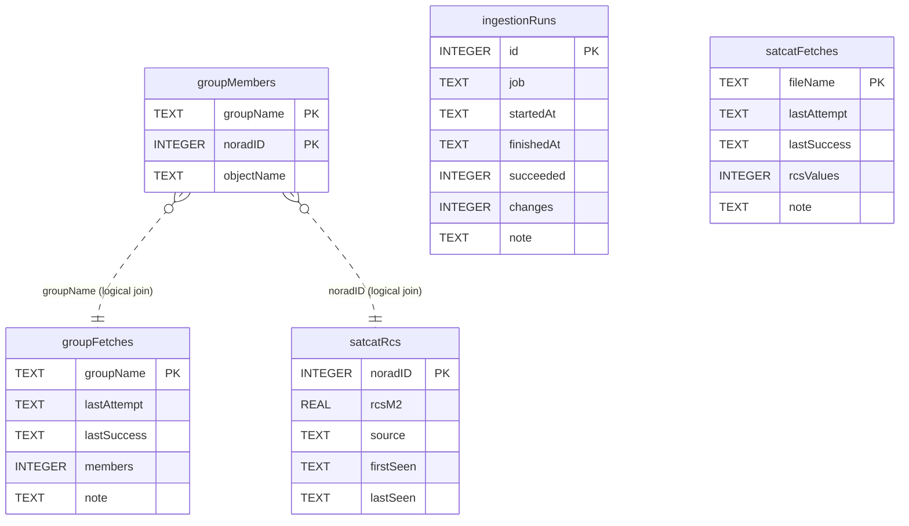

Indexes (besides the primary keys):

- `groupMembers`: `groupMembersByNorad` on (noradID)
- `ingestionRuns`: `ingestionRunsByJob` on (job, finishedAt)

## ingestionSatNOGS.db

ingestion database; introspected from the file databases\ingestionSatNOGS.db (a read-only copy; the original is never opened).

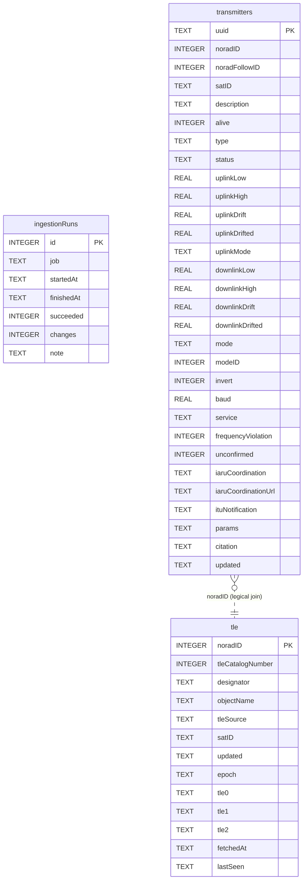

Indexes (besides the primary keys):

- `ingestionRuns`: `ingestionRunsByJob` on (job, finishedAt)
- `tle`: `tleByDesignator` on (designator)
- `transmitters`: `transmittersByNorad` on (noradID)

## ingestionGCAT.db

ingestion database; introspected from the file databases\ingestionGCAT.db (a read-only copy; the original is never opened).

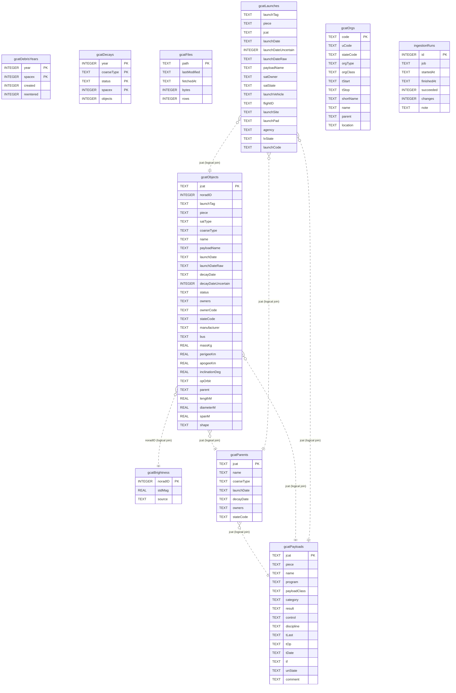

Indexes (besides the primary keys):

- `gcatLaunches`: `gcatLaunchesByTag` on (launchTag)
- `gcatObjects`: `gcatObjectsByLaunch` on (launchTag)
- `gcatObjects`: `gcatObjectsByNorad` on (noradID)
- `ingestionRuns`: `ingestionRunsByJob` on (job, finishedAt)

## ingestionNews.db

ingestion database; introspected from the file databases\ingestionNews.db (a read-only copy; the original is never opened).

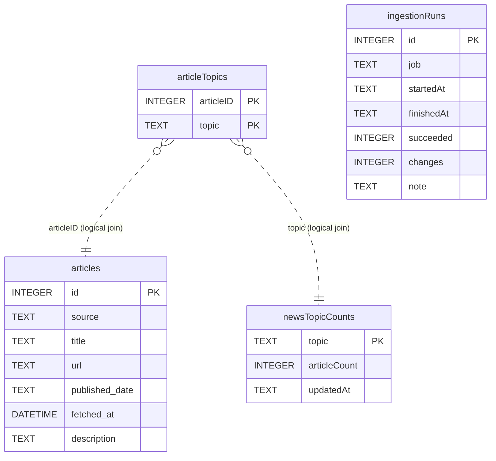

Indexes (besides the primary keys):

- `articleTopics`: `articleTopicsByTopic` on (topic)
- `articles`: `articlesByPublishedDate` on (published_date)
- `articles`: `sqlite_autoindex_articles_1` on (url) unique
- `ingestionRuns`: `ingestionRunsByJob` on (job, finishedAt)

## ingestionGroundSegment.db

ingestion database; introspected from the file databases\ingestionGroundSegment.db (a read-only copy; the original is never opened).

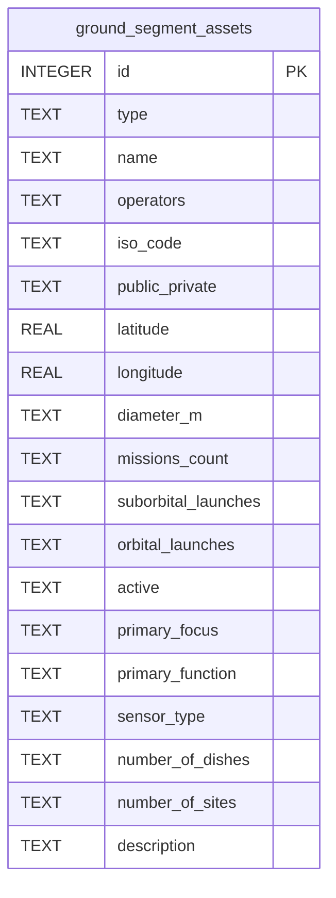

## ingestionSkyCatalogue.db

ingestion database; introspected from the file databases\ingestionSkyCatalogue.db (a read-only copy; the original is never opened).

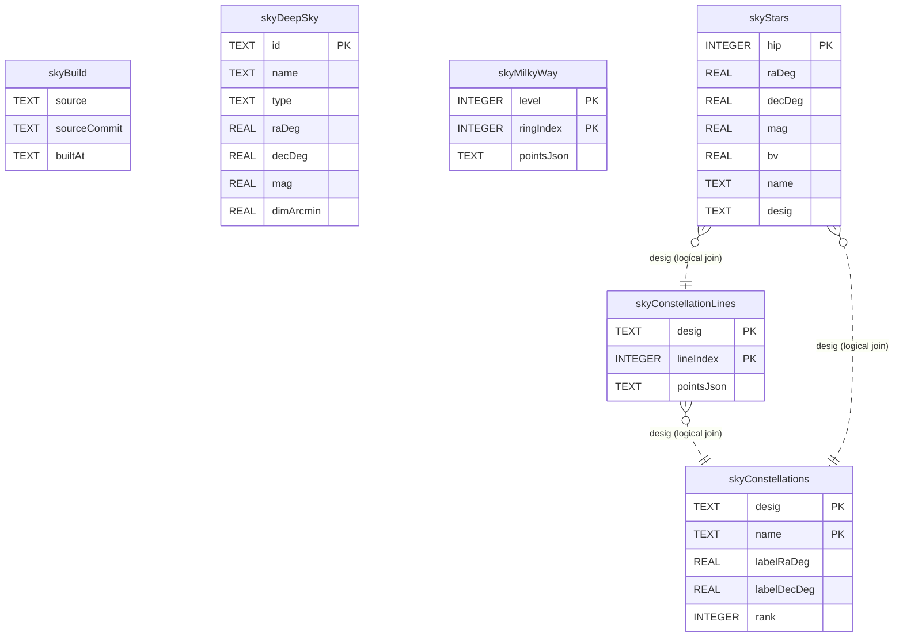

## ingestionGeoIP.db

ingestion database; the file does not exist on this machine; schema read from the code that creates it; CREATE statements in 0_tools/buildGeoIPDb.py.

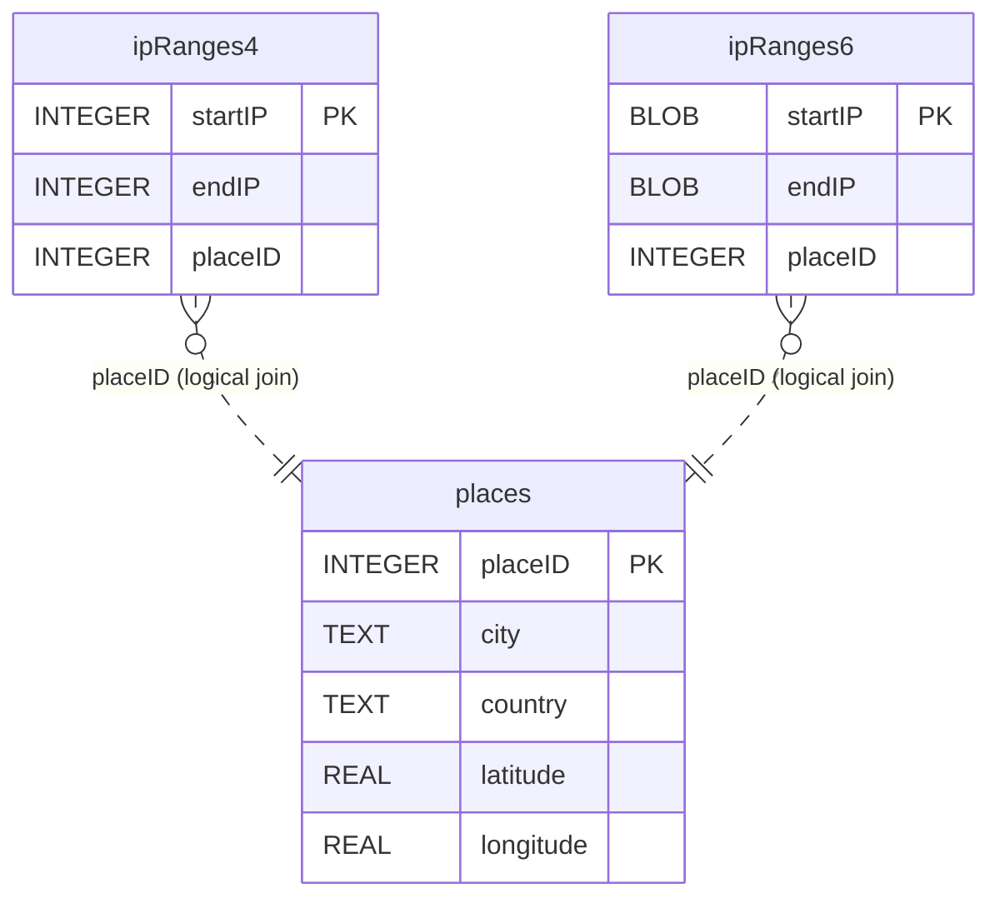

## ingestionSWPC.db

ingestion database; introspected from the file databases\ingestionSWPC.db (a read-only copy; the original is never opened).

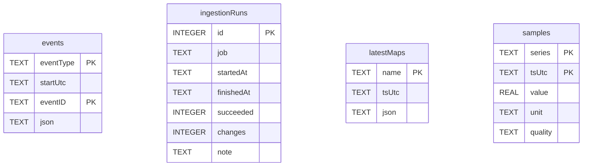

Indexes (besides the primary keys):

- `events`: `eventsByStart` on (eventType, startUtc)
- `ingestionRuns`: `ingestionRunsByJob` on (job, finishedAt)

## ingestionGFZ.db

ingestion database; introspected from the file databases\ingestionGFZ.db (a read-only copy; the original is never opened).


Indexes (besides the primary keys):

- `events`: `eventsByStart` on (eventType, startUtc)
- `ingestionRuns`: `ingestionRunsByJob` on (job, finishedAt)

## ingestionDONKI.db

ingestion database; introspected from the file databases\ingestionDONKI.db (a read-only copy; the original is never opened).


Indexes (besides the primary keys):

- `events`: `eventsByStart` on (eventType, startUtc)
- `ingestionRuns`: `ingestionRunsByJob` on (job, finishedAt)

## ingestionGCR.db

ingestion database; introspected from the file databases\ingestionGCR.db (a read-only copy; the original is never opened).


Indexes (besides the primary keys):

- `events`: `eventsByStart` on (eventType, startUtc)
- `ingestionRuns`: `ingestionRunsByJob` on (job, finishedAt)

## ingestionSILSO.db

ingestion database; introspected from the file databases\ingestionSILSO.db (a read-only copy; the original is never opened).

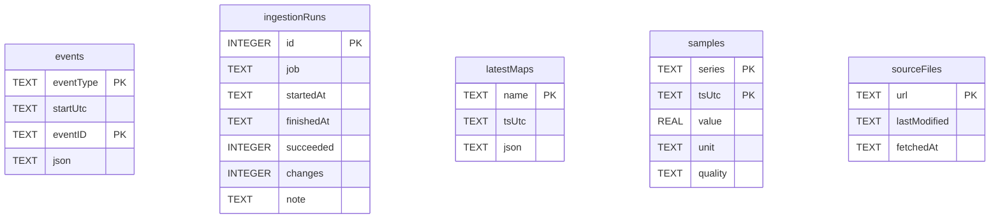

Indexes (besides the primary keys):

- `events`: `eventsByStart` on (eventType, startUtc)
- `ingestionRuns`: `ingestionRunsByJob` on (job, finishedAt)

## ingestionTEC.db

ingestion database; the file does not exist on this machine; schema read from the code that creates it; CREATE statements in scripts/spaceWeatherSamples.py; CREATE statements in scripts/ingestionLog.py; CREATE statements in scripts/ingestionTEC.py.

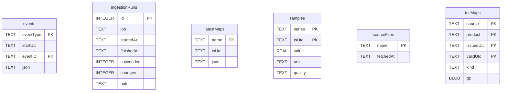

Indexes (besides the primary keys):

- `events`: `eventsByStart` on (eventType, startUtc)
- `tecMaps`: `tecMapsByValid` on (source, validUtc)

## siteOrbital.db

site database; introspected from the file databases\siteOrbital.db (a read-only copy; the original is never opened).

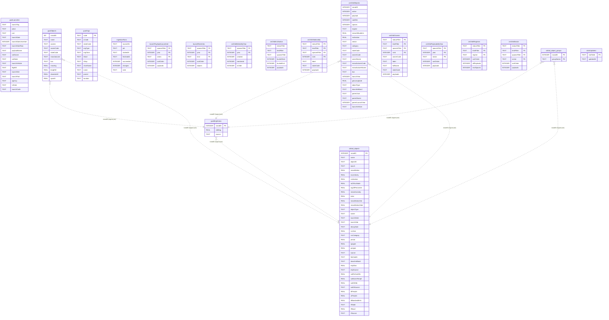

Indexes (besides the primary keys):

- `gcatLaunches`: `gcatLaunchesByTag` on (launchTag)
- `gcatObjects`: `gcatObjectsByNorad` on (noradID)
- `orbital_object_groups`: `idx_orbital_object_groups_group` on (groupName)

## siteNews.db

site database; introspected from the file databases\siteNews.db (a read-only copy; the original is never opened).

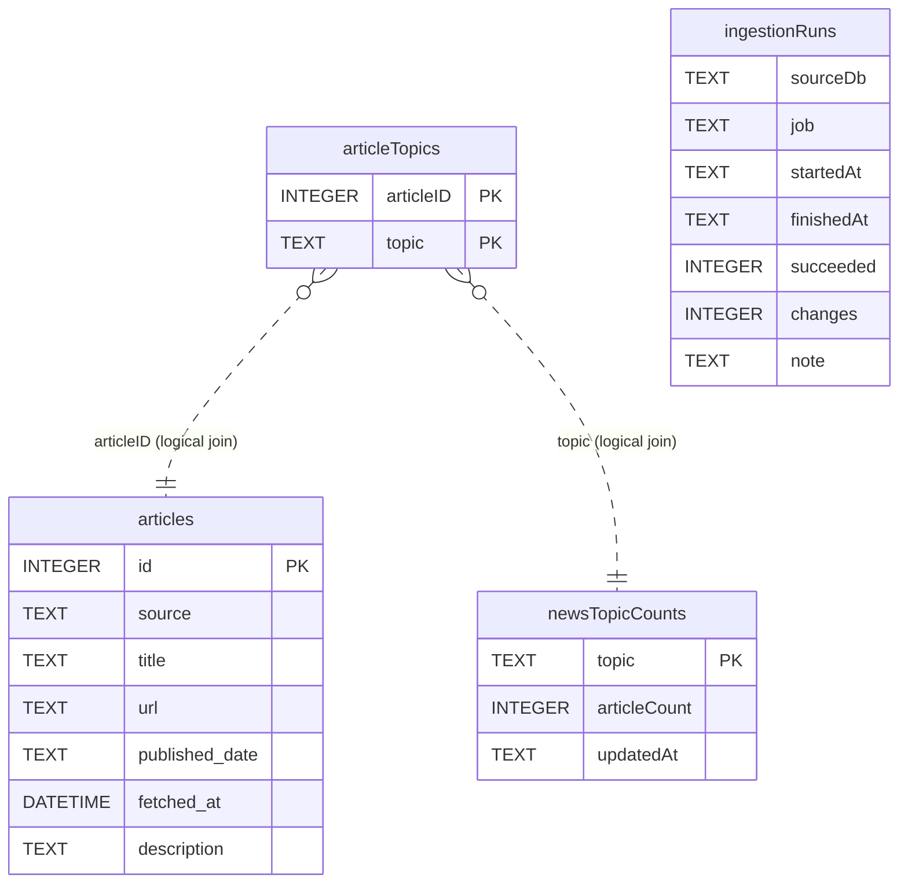

Indexes (besides the primary keys):

- `articleTopics`: `articleTopicsByTopic` on (topic)
- `articles`: `articlesByPublishedDate` on (published_date)
- `articles`: `sqlite_autoindex_articles_1` on (url) unique

## siteSky.db

site database; introspected from the file databases\siteSky.db (a read-only copy; the original is never opened).

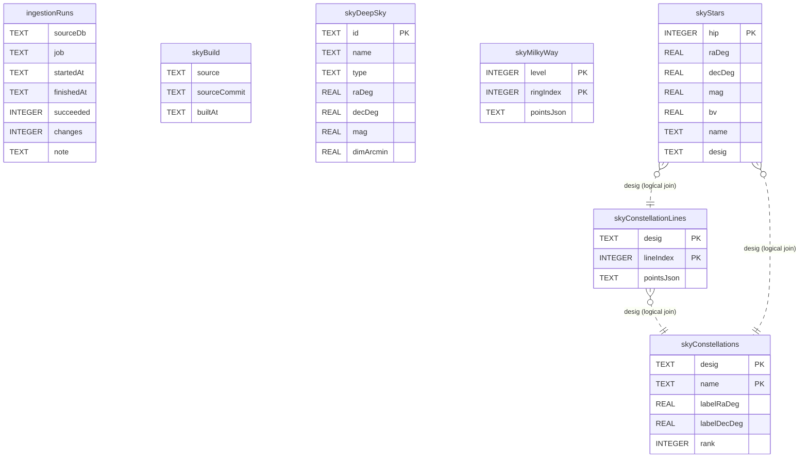

## siteGroundSegment.db

site database; introspected from the file databases\siteGroundSegment.db (a read-only copy; the original is never opened).

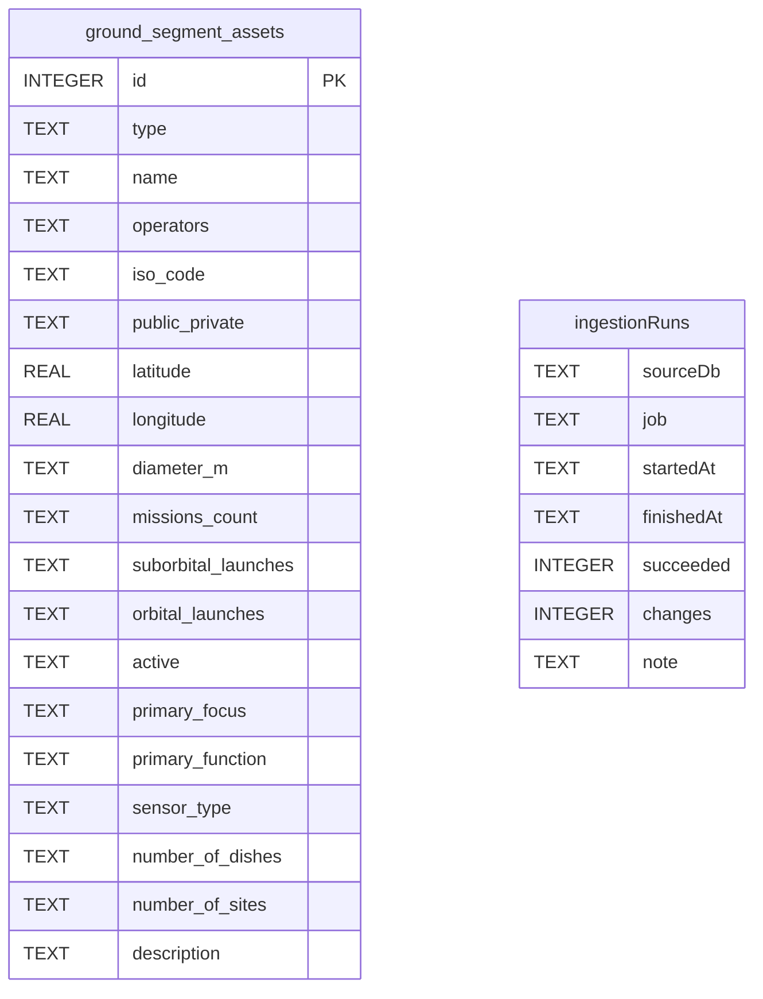

## siteWeather.db

site database; the file does not exist on this machine; schema read from the code that creates it; CREATE statements in scripts/publishSite.py; CREATE statements in scripts/publishSite.py.

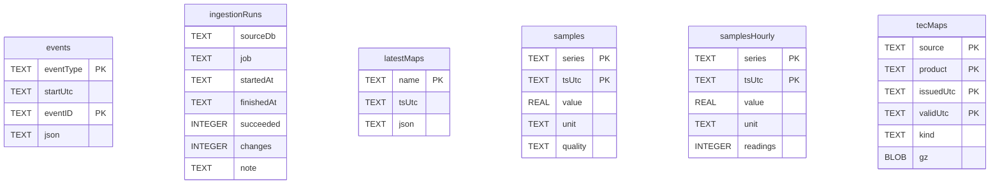

Indexes (besides the primary keys):

- `events`: `eventsByStart` on (eventType, startUtc)
- `tecMaps`: `tecMapsByValid` on (source, validUtc)

## inboxBugReports.db

inbox database; the file does not exist on this machine; schema read from the code that creates it; CREATE statements in server.py.

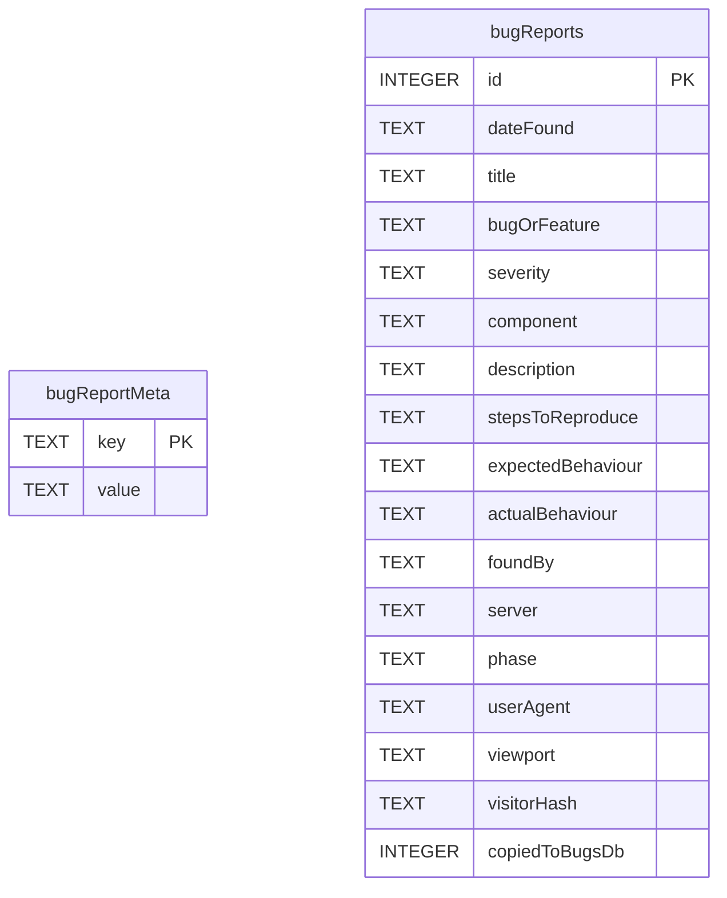

Indexes (besides the primary keys):

- `bugReports`: `idx_bugReports_visitor` on (visitorHash, dateFound)

## inboxUsage.db

inbox database; the file does not exist on this machine; schema read from the code that creates it; CREATE statements in scripts/visitCounter.py.

```mermaid
erDiagram
    logins {
        TEXT day PK
        TEXT city PK
        TEXT country PK
        REAL latitude
        REAL longitude
        INTEGER logins
    }
```

## orbitalObjects.db

legacy database; introspected from the file databases\orbitalObjects.db (a read-only copy; the original is never opened).

```mermaid
erDiagram
    celestrak_fetch_log {
        TEXT groupName PK
        REAL lastAttempt
    }
    ingestionRuns {
        INTEGER id PK
        TEXT job
        TEXT startedAt
        TEXT finishedAt
        INTEGER succeeded
        INTEGER changes
        TEXT note
    }
    orbital_object_groups {
        INTEGER noradID PK
        TEXT groupName PK
    }
    orbital_objects {
        INTEGER noradID PK
        TEXT name
        TEXT epoch
        TEXT objectType
        TEXT owner
        TEXT launchDate
        TEXT decayDate
        REAL rcsSize
        TEXT source
        DATETIME fetchedAt
        REAL period
        REAL apogee
        REAL perigee
        TEXT objectID
        REAL meanMotion
        REAL eccentricity
        REAL inclination
        REAL raOfAscNode
        REAL argOfPericenter
        REAL meanAnomaly
        REAL bstar
        REAL meanMotionDot
        REAL meanMotionDdot
        TEXT launchSite
        TEXT downlinkBand
        REAL eirpDbw
        TEXT eirpSource
        REAL satRxGainDbi
        REAL satNoiseTempK
        REAL satGtDbk
        TEXT satGtSource
        REAL dlFreqHz
        REAL ulFreqHz
        REAL dlBandwidthHz
        TEXT rfMode
        REAL rfBaud
        TEXT rfSource
    }
    orbital_object_groups }o..|| celestrak_fetch_log : "groupName (logical join)"
    orbital_object_groups }o..|| orbital_objects : "noradID (logical join)"
```

Indexes (besides the primary keys):

- `ingestionRuns`: `ingestionRunsByJob` on (job, finishedAt)
- `orbital_object_groups`: `idx_orbital_object_groups_group` on (groupName)

## onOrbitStats.db

legacy database; introspected from the file databases\onOrbitStats.db (a read-only copy; the original is never opened).

```mermaid
erDiagram
    launchPayloadsLaunched {
        TEXT spacexFilter PK
        INTEGER year PK
        TEXT series PK
        INTEGER sortOrder
        INTEGER payloads
    }
    launchReentries {
        TEXT spacexFilter PK
        INTEGER year PK
        TEXT kind PK
        INTEGER sortOrder
        INTEGER objects
    }
    onOrbitDebrisByYear {
        TEXT spacexFilter PK
        INTEGER year PK
        INTEGER created
        INTEGER reentered
        INTEGER inOrbit
    }
    onOrbitInclination {
        TEXT statusFilter
        TEXT kindFilter
        TEXT spacexFilter
        INTEGER bucketStart
        INTEGER bucketEnd
        INTEGER payloads
    }
    onOrbitNationality {
        TEXT statusFilter PK
        TEXT kindFilter PK
        TEXT spacexFilter PK
        INTEGER rank PK
        TEXT label
        TEXT stateCode
        INTEGER payloads
    }
    onOrbitObjects {
        INTEGER noradID
        INTEGER active
        INTEGER payload
        INTEGER satellite
        INTEGER spacex
        TEXT regime
        REAL meanAltitudeKm
        REAL inclination
        TEXT sector
        TEXT category
        TEXT stateCode
        TEXT ownerCode
        TEXT ownerName
        TEXT manufacturerCode
        TEXT manufacturerName
        TEXT bus
        INTEGER launchYear
        REAL geoLongitude
        TEXT objectType
        TEXT downlinkBand
        TEXT parentJcat
        TEXT parentName
        INTEGER parentLaunchYear
        TEXT launchVehicle
    }
    onOrbitOwners {
        TEXT statusFilter PK
        TEXT kindFilter PK
        TEXT spacexFilter PK
        INTEGER rank PK
        TEXT ownerCode
        TEXT label
        TEXT fullName
        TEXT stateCode
        INTEGER payloads
    }
    onOrbitPayloadsByYear {
        TEXT spacexFilter PK
        INTEGER year PK
        TEXT sector PK
        INTEGER sortOrder
        INTEGER payloads
    }
    onOrbitRegimes {
        TEXT statusFilter PK
        TEXT kindFilter PK
        TEXT regime PK
        INTEGER sortOrder
        INTEGER allPayloads
        INTEGER exclSpacex
    }
    onOrbitSector {
        TEXT statusFilter PK
        TEXT kindFilter PK
        TEXT spacexFilter PK
        TEXT sector PK
        INTEGER sortOrder
        INTEGER payloads
    }
    statsUpdated {
        TEXT statTable PK
        TEXT updatedAt
    }
```
